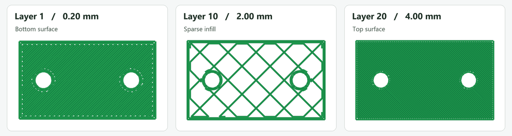

# Bambu X2D Printing Skill

A Windows skill for turning a brief, drawing, CAD file, mesh or Bambu Studio project into an editable model and a measured X2D plate. It uses FreeCAD for precise features, Blender for mesh and surface edits, and the installed Bambu Studio slicer for toolpaths. Use it for a design-only change, an offline slice, or a human-approved print handoff.

**[Windows setup](skills/bambu-x2d-printing/references/hosts.md)** · [Read the skill](skills/bambu-x2d-printing/SKILL.md) · [Worked examples](skills/bambu-x2d-printing/references/examples.md) · [Test results](docs/validation.md)



The mounting tab shown above was created in an independent agent trial. Its native model and exported mesh measured 38 × 22 × 4 mm. Both 4 mm bores survived slicing, with centers 24 mm apart.

## TRELLIS.2 now turns a single photo into a 3D mesh

For single-image 3D estimates, install the optional headless TRELLIS.2 backend from the same checkout. Its terminal command and stdio MCP server run the model locally on a Windows x64 Vulkan GPU. The output opens in Blender, with a sized STL available for Bambu Studio. [Install and use TRELLIS.2](skills/bambu-x2d-printing/references/trellis2.md)

## Install in Codex on Windows

Clone this repository from PowerShell.

```powershell
git clone https://github.com/AleksanderAmid/bambu-x2d-printing.git
Set-Location bambu-x2d-printing
```

The skill uses three local Model Context Protocol (MCP) servers. The Windows installer fetches the exact revisions used in the test report and builds their locked dependencies. Each server keeps its upstream license.

| Codex registration | Tested desktop app | MCP dependency | What it does here |
|---|---|---|---|
| `freecad` | FreeCAD 1.1.4 | [neka-nat/freecad-mcp 0.1.32](https://github.com/neka-nat/freecad-mcp/tree/246f608d5de49089aadc41d2d91cfce2ad8a44cd) | Creates and measures parametric solids through the FreeCAD workbench. |
| `blender` | Blender 5.3.0 | [ahujasid/mcp-for-blender 2.3.1](https://github.com/ahujasid/mcp-for-blender/tree/a5a8acf2c6ae44a73670e0caf34663f16456d645) | Edits meshes and inspects evaluated geometry through the Blender add-on. |
| `bambu-studio` | Bambu Studio 02.09.01.70 | [DMontgomery40/bambu-printer-mcp 1.1.98](https://github.com/DMontgomery40/bambu-printer-mcp/tree/9a590fbd1e83e875ef093fc2093d9a021161ef95) | Slices with the local X2D presets and inspects the saved plate. |

On a new workstation, install the desktop apps, Git, uv, Python 3.12, Node.js 24 with npm, and the Codex CLI. Build the three servers with the command below, then enable the two GUI add-ons and register the three servers using the [Windows setup guide](skills/bambu-x2d-printing/references/hosts.md). An existing, working three-server installation can go straight to copying the skill. Offline modeling and slicing work without printer credentials.

```powershell
.\tools\install-mcps.ps1
```

From the repository root, copy the skill into your Codex skills directory. The commands install one user-level copy and stop if it already exists.

```powershell
$skillsParent = Join-Path $env:USERPROFILE '.codex/skills'
if ($env:CODEX_HOME) { $skillsParent = Join-Path $env:CODEX_HOME 'skills' }
$skillTarget = Join-Path $skillsParent 'bambu-x2d-printing'
if (Test-Path -LiteralPath $skillTarget) { throw "Review the existing skill before updating: $skillTarget" }
New-Item -ItemType Directory -Path $skillsParent -Force | Out-Null
Copy-Item -LiteralPath './skills/bambu-x2d-printing' -Destination $skillTarget -Recurse
```

Open a fresh Codex session. Invoke `$bambu-x2d-printing` or ask for an X2D modeling job. Open FreeCAD and Blender when their live workbenches are needed. Studio CLI slicing can work entirely offline. This release was installed and tested in Codex. For a new workstation or a Claude Code installation, follow the [Windows setup and discovery guide](skills/bambu-x2d-printing/references/hosts.md).

> Use $bambu-x2d-printing to model a 38 × 22 × 4 mm mounting tab with two 4 mm through-holes on 24 mm centers. Save the editable FreeCAD file, measure the exported STL, and prepare a preview for an X2D with 0.4 mm nozzles, PLA Basic and textured PEI.
>
> Use $bambu-x2d-printing to widen only the center hole in this washer STL to 9.6 mm. Preserve its outer profile and thickness. Give me an editable Blender file and a revised STL.
>
> Use TRELLIS.2 to turn this single photo into a rough 3D bust. Keep the reference mesh for Blender and give me a 100 mm version I can preview in Bambu Studio.

## What's included

| Topic | Reference |
|---|---|
| Inputs, tool order, checkpoints and output | [Skill entry point](skills/bambu-x2d-printing/SKILL.md) |
| Nominal dimensions, datums, fit coupons and independent mesh measurements | [Dimensional verification](skills/bambu-x2d-printing/references/dimensions.md) |
| Parametric changes, mesh repair and artistic edits | [FreeCAD workflow](skills/bambu-x2d-printing/references/solid-modeling.md) · [Blender workflow](skills/bambu-x2d-printing/references/mesh-modeling.md) |
| Orientation, small features, support material and assembly | [Design for the printed part](skills/bambu-x2d-printing/references/fdm-design.md) |
| X2D nozzle reach, project preservation, plate indexes and final approval | [Slicing](skills/bambu-x2d-printing/references/slicing.md) · [Print handoff](skills/bambu-x2d-printing/references/handoff.md) |
| All 102 tool entries, plus prompts and resources | [FreeCAD · 18](skills/bambu-x2d-printing/references/freecad-tools.md) · [Blender · 10](skills/bambu-x2d-printing/references/blender-tools.md) · [Bambu · 74](skills/bambu-x2d-printing/references/bambu-tools.md) · [Other MCP capabilities](skills/bambu-x2d-printing/references/hosts.md) |
| Primary sources, rationale and pinned upstream revisions | [Research notes](skills/bambu-x2d-printing/references/sources.md) |

The skill keeps design dimensions, exported geometry, slicer estimates and physical measurements separate. The X2D Windows route ends in Bambu Studio. The operator either presses the final control or explicitly authorizes a single click on the reviewed job in a client with trusted desktop control.

## Run the checks

Python 3.11+ runs the portable tests and file helpers. The live catalog check also needs the Python MCP SDK. The installed FreeCAD MCP server environment already has it. The live qualification uses the local Codex CLI and all three installed applications. Use clean, saved GUI sessions and Blender Object Mode for live qualification.

```powershell
python -B -m unittest discover -s tests -p 'test_*.py' -v
python -B tools/catalog.py --offline
# With a Python interpreter that has the MCP SDK installed
python -B tools/catalog.py
# From a configured Windows Codex installation
python -B tests/live_codex.py
```

The live qualification opens an ephemeral Codex session, creates original test files in a fresh local temporary directory, reopens them, and exercises offline slicing. It checks both the accepted single-color plate and the pinned inspector's rejection of a two-color plate. It prints the artifact location. For nonstandard preset locations pass `--filament` and `--process`. Pass `--config` and, if needed, `--freecad`, `--blender` and `--bambu` to catalog discovery. The live qualification uses the three default registration names. For maintenance, inspect `tools/catalog.py --snapshot`, review changed signatures and update the affected reference and baseline together.

Community project. The [MIT license](LICENSE) covers the original skill, examples and checks. The linked applications, upstream MCPs, assets and profiles have their own licenses.
