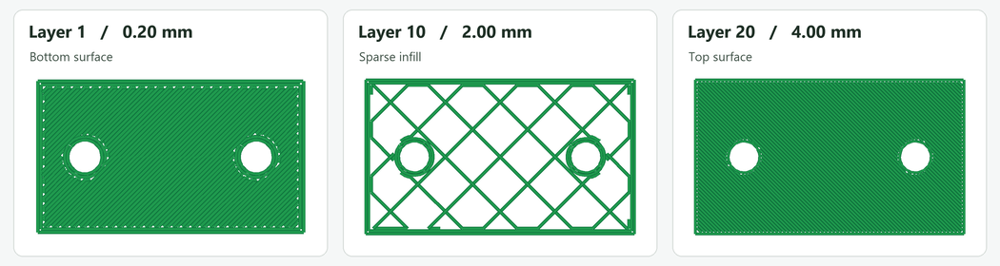

# Windows release verification

The release targets FreeCAD 1.1.4, Blender 5.3.0 and Bambu Studio 02.09.01.70. Tests used the three local MCP servers listed in the [version and source notes](../skills/bambu-x2d-printing/references/sources.md). The evidence below is from digital files, app runtime measurements and local slicer output.

## Windows installation test

Windows PowerShell 5.1 ran the [MCP installer](../tools/install-mcps.ps1) in an empty directory whose path contained spaces. It downloaded all three pinned commits, built both Python servers with uv and the Studio connector with Node.js 24, and built them again successfully on a repeat run. In a separate fixture the installer detected a local edit and preserved it.

The published [setup commands](../skills/bambu-x2d-printing/references/hosts.md) installed both GUI add-ons into clean profile folders and registered the three new server builds in an isolated Codex configuration. The README installed a byte-identical copy of the skill. Live discovery found all 102 tools. The fresh servers then completed the qualification below against the workstation's already installed desktop applications and running GUI listeners.

## End-to-end qualification

A fresh Codex app-server session discovered the installed skill and called the configured servers directly. FreeCAD created a parametric washer revision with a 6 mm bore and 3 mm thickness, changed it to 8 mm and 4 mm while preserving its 20 mm OD, saved both revisions, and reopened the result. Blender checked a closed mesh and exported a second STL. An independent section of the saved artifact verified both radii. Studio created a one-plate X2D slice with PLA Basic, textured PEI and two 0.4 mm nozzles. The file inspector returned 20 layers, 455 s and 0.88 g. These are slicer estimates for the fixture.

The same run checked a 3MF with repeated instances and an inch-declared root unit, composed component/build translations, and detected a changed instance count. The local inspector rejected an incorrect nozzle pair and an absent second plate. The X2D nozzle-envelope check recognized a feature reachable by the main head and outside auxiliary reach. Run [the live qualification](../tests/live_codex.py) to produce fresh artifacts and a receipt. Slicer versions and file metadata can change a hash or estimate. Verify identity within the job being reviewed.

The two-color trial assembled blue and yellow parts in a common coordinate system, extracted them to verify their Z placement and slots, and sliced the assembly using two PLA Basic profiles. Studio attributed the first ten layers to the blue part and the final ten to yellow. Both used material on the object. Connector 1.1.98 rejected the saved file at Studio's multi-extruder pre-cooling command. The qualification checks the reported line against the exact artifact and expects the refusal. This plate remains pending inspection. [Color-workflow guidance](../skills/bambu-x2d-printing/references/slicing.md)

## Optional local image-to-mesh backend

On Windows 11 with a Radeon 8060S, the Vulkan backend reconstructed a 189 × 231 px opaque-background bust image using TRELLIS.2, resolution 512 and seed 42. The initial raw geometry-only export contained 3,448,292 triangles and 139,362 open edges. The published worker uses the engine’s cleaned surface and simplifies it to an editable reference. The MCP generation took about 4 min 21 s and returned 150,000 triangles. Its scaled STL had zero open edges and 4,468 edges shared by more than two faces.

A separate CPU wrap took about 22 s. The reopened STL measured 86.5127 × 86.0887 × 100.0000 mm at the chosen preview height. It had one body, consistent winding, and zero open edges, overused edges or zero-area faces. Blender 5.3 reopened the editable scene at those dimensions and Bambu Studio imported all 150,000 triangles. The single-view rear geometry is inferred. This test covers a digital model and an unsliced import. The optional 1024 run was stopped during detail inference and has no verified export in this qualification.

The stdio test checks tool discovery, generation, job polling and retrieval from a fresh connection. With the backend installed, run the commands below from the repository root. Choose new output directories. [Install and use TRELLIS.2](../skills/bambu-x2d-printing/references/trellis2.md)

```powershell
$python = Join-Path (uv tool dir) 'x2d-trellis/Scripts/python.exe'
& $python tests/trellis2_checks.py -v
& $python tests/live_trellis2.py '.\bust.png' '.\draft' --wrap-dir '.\watertight'
```

## Independent agent trials

| Brief | Observable result |
|---|---|
| Create a 38 × 22 × 4 mm mounting tab with two Ø4 mm through-bores at 24 mm pitch, editable CAD and a sliced preview | Reopened fully constrained native design and changed pitch/thickness in an unsaved test. Independent STL cuts measured ~3.99985 mm limiting bore size and centers at X = −12 and +12 mm. One closed, consistently wound shell. Both bores remained open in 20 sliced layers. Studio estimated 579 s and 2.40 g. |
| Widen only an existing washer bore to 9.6 mm and supply BLEND/STL | The re-opened scene and independent STL sections near both faces and at mid-height gave a 9.6000 mm limiting opening. All 316 outside vertices retained their original coordinates. OD remained 20 mm and thickness 4 mm. The design-only request ended with files. |



The release incorporates two findings from those trials. Blender MCP's optional status tool can return a missing-module message while scene reading and bpy execution work. The skill gives a verified fallback. Slicing examples explicitly identify the build plate and process, and the design-only route ends before slicing.

## Scope of evidence

All 14 portable regression tests passed on Windows. They cover unit conversion, a wrong through-bore with the right overall size, mesh winding/open edges, transform errors, per-nozzle reach, missing MCP registration, an altered plate file, and changes after review. A simulated final control tests both approval routes and an ambiguous click result.

Live discovery returned 18 FreeCAD, 10 Blender and 74 Bambu tools. The three tool guides matched all 573 required and optional parameter occurrences across those tools. The host guide covers the 9 prompts, 6 resources and 3 resource templates advertised by this installation. The [catalog check](../tools/catalog.py) detects changes to the recorded interfaces and checks reference coverage.

Real job transmission, printer telemetry, physical dimensions, strength, material adhesion, third-party generators, optional commercial/CAD bridges and Claude execution require their own environment or operator evidence. The release tests invoked no physical print and make no comparison of agent performance against competing skills.
